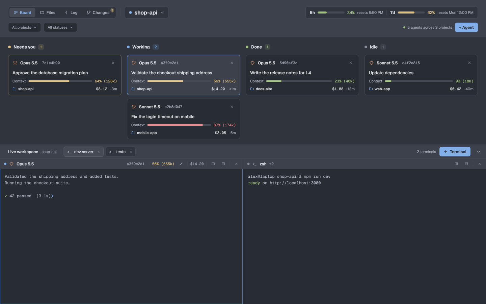
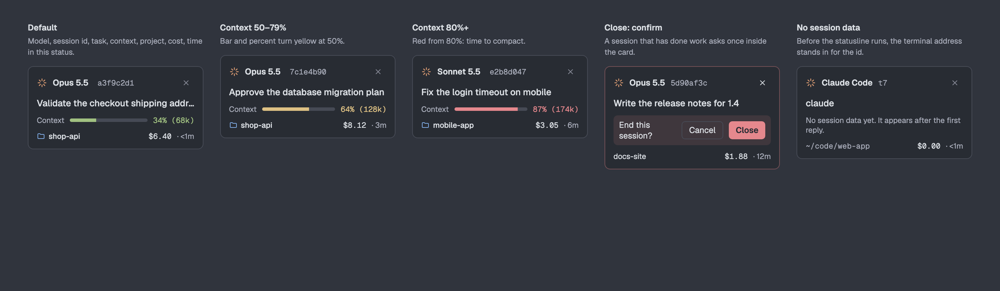
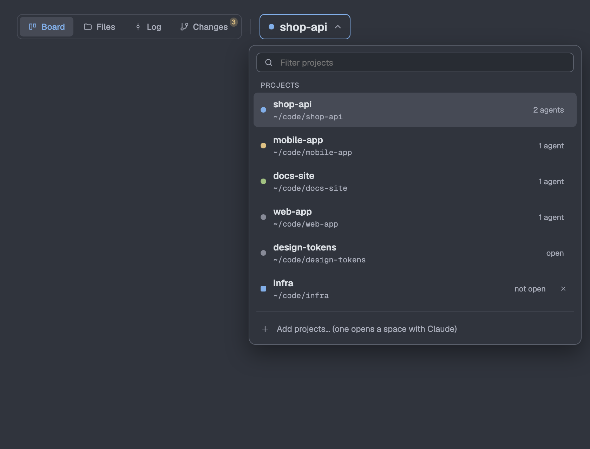
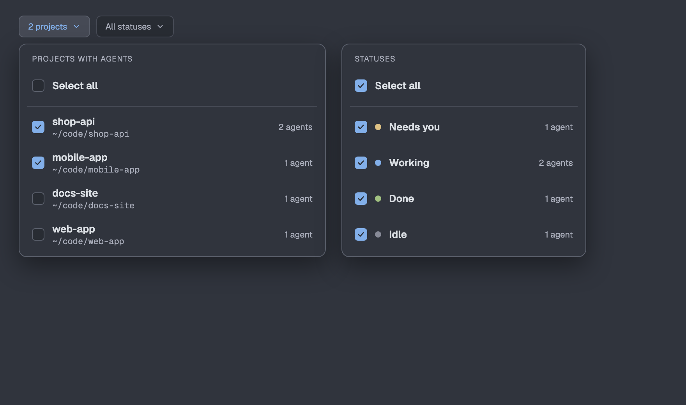
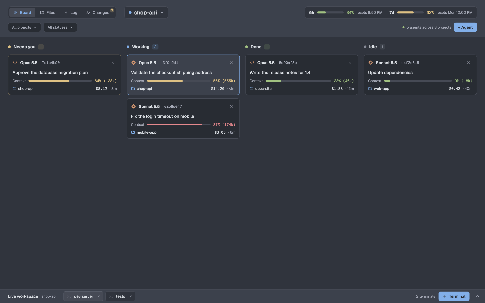
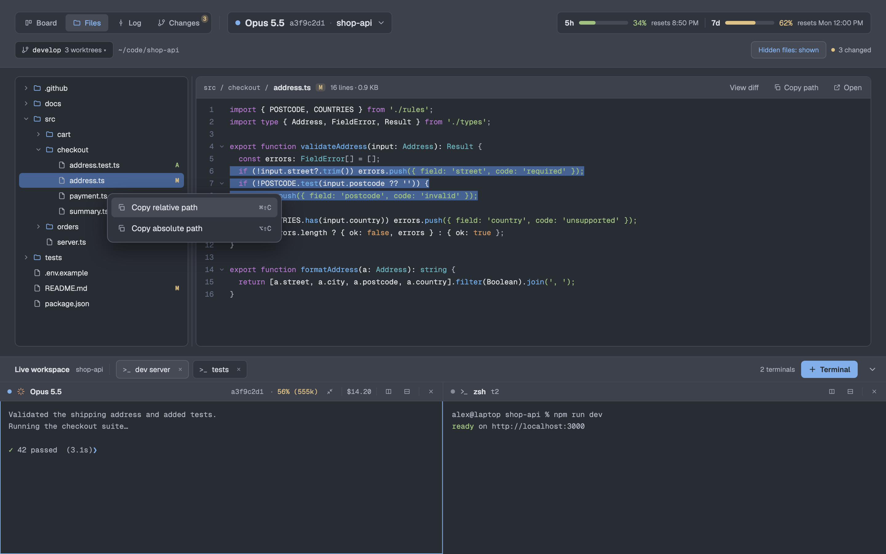
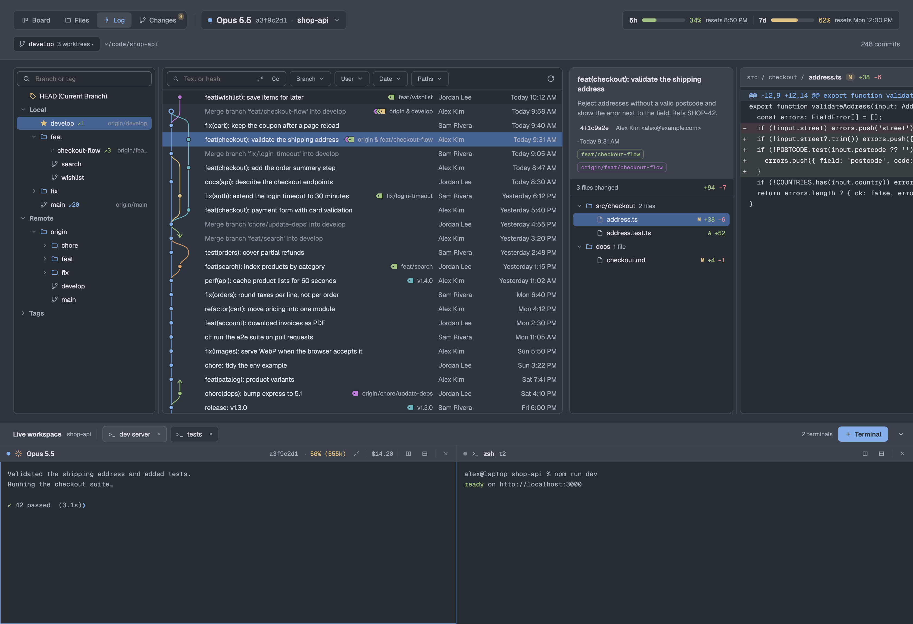
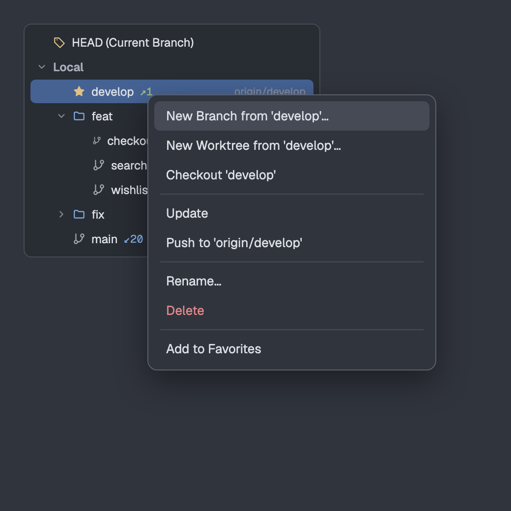
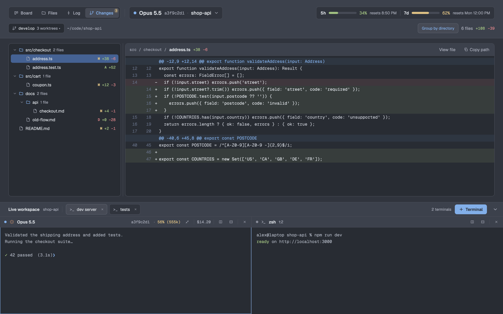

# Corral

An agent board layout for [Herdr](https://herdr.dev). Every Claude Code session is a card, sorted by status. Below the board, the live terminals of the active space. Three more views follow the agent you pick: its files, its git history, and its uncommitted changes.



The screenshots show sample data.

## Install

You need:

- the Herdr desktop app (`herdr-app`);
- Claude Code, for the session data on the cards;
- `git`, for Files, Log and Changes.

Then:

```sh
git clone https://github.com/romant094/corral.git
cd corral
./install.sh --statusline
herdr-app do layout.switch --name corral
```

`install.sh` copies `layouts/corral.json`, `mods/corral/` and `themes/` into `~/.config/herdr-app` (or `$HERDR_APP_HOME`), then runs `herdr-app check` on the mod. With `--statusline` it also copies the Claude Code statusline hook into `~/.claude/scripts/`. To go back to your own layout, press `ctrl-shift-l` or run `herdr-app do layout.switch --name main`.

### Connect the session data

The cards read the JSON that Claude Code sends to its statusline. Set the hook in `~/.claude/settings.json`:

```json
{
  "statusLine": { "type": "command", "command": "python3 ~/.claude/scripts/corral-statusline.py" }
}
```

The hook prints one line (`model | context | cost | [folder]`) and saves the JSON to `~/.cache/corral/sessions/<claude pid>.json`. The mod matches each file to its terminal by the terminal's foreground pid. If you already have a statusline, call the script from it and pass the same stdin. Without the hook the board still works; the cards say that no session data is available yet.

### What the mod can do on your machine

Herdr mods are trusted JavaScript. Corral:

- runs `git` in the folders of your agents (read commands every few seconds; the branch actions you click also write: checkout, push, delete and so on);
- runs `hc` (herdr-core) to find a terminal's foreground pid and to send `/compact` when you ask for it;
- runs `osascript` on macOS for the multi-folder picker, and `open` for "Open in the default app";
- reads `~/.cache/corral/sessions/` and the files of the folder you browse in Files.

It does not use the network itself. `git fetch`, `pull` and `push` reach your git remotes when you click them.

## Board


- **Columns:** Needs you, Working, Done, Idle. A card shows the model, the session id (click to copy), the task, context use with tokens, the project, the cost and the time in this status. The focused agent's card is outlined. A session that has done work asks before it closes.
- **Context colors:** green below 50%, yellow from 50%, red from 80%, as in the statusline. The 5-hour and 7-day plan limits in the header use the same colors and show the reset time.
- **Filters:** "All projects" and "All statuses" open lists with checkboxes. A status you leave out hides its column.
- **+ Agent** starts Claude in a new tab of the active space.



### Projects



The picker lists project folders: saved ones, folders of open spaces (saved when you open them) and folders where an agent runs. Each agent counts once, in the deepest folder that holds it. Rows with agents come first. A click goes to the agent, else to the open space, else opens a space there and starts Claude. "Add projects…" takes several folders at once on macOS.



### Live workspace

The bar under the board holds the plain terminals of the active space as chips: drag one to reorder, drop it on Right or Below to show it beside the active pane, double-click to rename. "+ Terminal" opens a shell. The chevron folds the terminals away with a short slide and brings them back to the same height.



Each pane header shows the status, the model, the session id (click to copy), the context use, a compact button that sends `/compact` after you confirm, the cost, split right, split down and close.

## Files



The agent's folder as a tree with git marks (M, A, D), and a read-only code view with syntax colors and text selection. Right-click a row, or press ⌘⇧C / ⌥⇧C (Ctrl+Shift+C / Alt+Shift+C on Linux and Windows), to copy the relative or absolute path. Drag the divider to resize the tree; each agent keeps its own width. The worktree picker shows another worktree of the same repository.

## Log



- **Branch tree:** HEAD, Local, Remote and Tags, in folders by `/`. Starred branches come first in their folder. A local branch shows commits to push (↗, green) and to pull (↙, blue) and its tracked branch; click a count to see just those commits. A click on a branch selects its newest commit; a double click filters the log to it.
- **History:** the whole history, the newest 500 commits first. The graph works as in IntelliJ: lanes close up to the left, each branch keeps its color, HEAD's commit is a ring, and an edge to a far parent is cut into a down arrow and an up arrow. Click an arrow to jump to the commit at its other end.
- **Filters:** text or hash (with regex and match case), Branch, User and Paths with several values each, and Date.
- **Details:** the message, hash (click to copy), author, date, refs and the changed files as a tree. Click a file to see its diff in a fourth panel.



Right-click a branch for: new branch or worktree from it, checkout, update, push, rename, delete (on the remote too, after a confirmation) and star. The fetch button over the list runs `git fetch --all --prune`. Each result shows as a toast.

## Changes



`git status` and `git diff HEAD` of the agent's folder, refreshed every 4 seconds. The files show as a folder tree or a flat list ("Group by directory", kept per repository). Click a file for its diff.

## Light and dark

The layout follows the system appearance with the `one-light` and `one-dark` themes in `themes/`. Code colors follow the theme.

## Development

```sh
./install.sh --link
```

This symlinks `main.js` and the layout to the checkout, so edits apply when Herdr reloads the mod. Icons stay copies, because Herdr does not load SVGs through a symlinked folder: run the script again after adding one. Check the mod after a change:

```sh
herdr-app check mods/corral
```

```
layouts/corral.json              the layout: header, top area, live workspace
mods/corral/main.js              one mod; props().role picks the part it draws
mods/corral/icons/               SVG icons
themes/one-dark.json, one-light.json
statusline/corral-statusline.py  Claude Code statusline hook
RECIPE.md                        the brief to rebuild it from scratch
preview.png                      the screenshot herdr.dev shows
```

## License

MIT
