# Corral

An agent board layout for [Herdr](https://herdr.dev). Every Claude Code session is a card, sorted by status. Below the board, the live terminals of the active space. Three more views follow the agent you pick: its files, its git history, and its uncommitted changes.

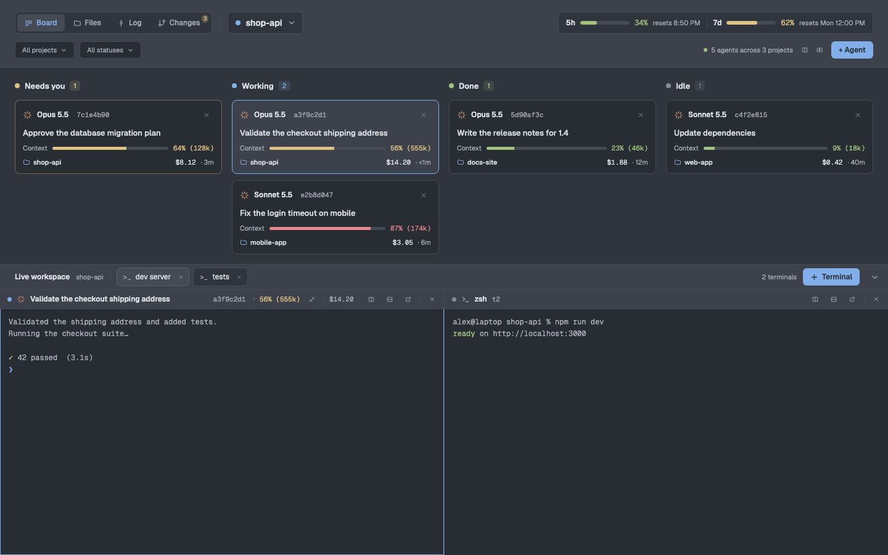

The screenshots show sample data.

## Install

You need:

- the Herdr desktop app (`herdr-app`);
- Claude Code, for the session data on the cards;
- `git`, for Files, Log and Changes.

Then:

```sh
git clone https://github.com/romant094/corral.git
cd corral
./install.sh --statusline
herdr-app do layout.switch --name corral
```

`install.sh` copies `layouts/corral.json`, `mods/corral/`, `themes/` and the Telegram bridge (`telegram/`) into `~/.config/herdr-app` (or `$HERDR_APP_HOME`), then runs `herdr-app check` on the mod. With `--statusline` it also copies the Claude Code statusline hook into `~/.claude/scripts/`; a hook installed before is always updated. Then it checks that `statusLine` in `~/.claude/settings.json` runs the hook, and if not, shows the current value and the line to set; in a terminal it offers to set it for you, after a timestamped backup (`settings.json.bak-<date>-<time>`). `--name <folder>` installs the mod into another folder, for a gallery install that had to rename it. It also adds Corral's keys (`mods/corral/keys.json`) to your `~/.config/herdr-app/keys.json`; a key you already use keeps its action. Herdr treats an edited `keys.json` as yours and stops adding its new default keys to it. To go back to your own layout, press `ctrl-shift-l` or run `herdr-app do layout.switch --name main`.

### Connect the session data

The cards read the JSON that Claude Code sends to its statusline. Set the hook in `~/.claude/settings.json`:

```json
{
  "statusLine": { "type": "command", "command": "python3 ~/.claude/scripts/corral-statusline.py" }
}
```

The hook prints one line (`model | context | cost | [folder]`) and saves the JSON to `~/.cache/corral/sessions/<claude pid>.json`. The mod matches each file to its terminal by the terminal's foreground pid. Without the hook the board still works; the cards say that no session data is available yet.

Claude Code runs one `statusLine` command. To keep a status line of your own, name its command in `CORRAL_STATUSLINE_CHAIN`:

```json
{
  "statusLine": { "type": "command", "command": "CORRAL_STATUSLINE_CHAIN='bash ~/.claude/my-statusline.sh' python3 ~/.claude/scripts/corral-statusline.py" }
}
```

The hook gives your command the same stdin JSON and prints its output instead of Corral's line, as the cards already show what that line does. It still saves the session file. If your command fails, prints nothing or takes more than 2 seconds, the hook prints its own line. When `install.sh` sets `statusLine` for you, it chains the command that was there.

### What the mod can do on your machine

Herdr mods are trusted JavaScript. Corral:

- runs `git` in the folders of your agents (read commands every few seconds; the branch actions you click also write: checkout, push, delete and so on);
- runs `hc` (herdr-core) to find a terminal's foreground pid, to send `/compact` when you ask for it, and to start saved sessions again after a restart (Settings → Restore);
- runs `osascript` on macOS for the multi-folder picker, and `open` for "Open in the default app";
- reads `~/.cache/corral/sessions/` and the files of the folder you browse in Files;
- from the settings: runs `node` with the Telegram bridge, `launchctl` for the bridge's service and writes `telegram.json`.

Network: Corral asks `github.com` for its latest release at start and every hour (turn it off in Settings → Updates), and `api.github.com` once per new release for its notes, and downloads a release from GitHub when you press Update. The Telegram bridge talks to `api.telegram.org` once you turn it on. `git pull` and `push` reach your git remotes when you click them; `git fetch --all --prune` runs when you open Log and when you click the fetch button.

## Settings

The gear right of the plan limits (or `herdr-app do corral.settings`) opens Corral's settings:

### Telegram

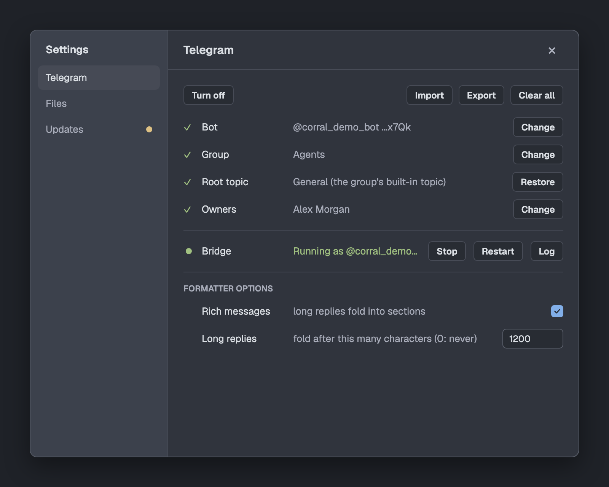

"Turn on", then two steps: paste the bot token (the row links to @BotFather), and make a new group with Topics on and press "Add the bot". Telegram opens, you pick that group and confirm; the bot gets its admin rights, you become its owner, and Corral starts the bridge. The root topic is the group's built-in General ("Restore" brings it back if it was hidden). More owners can be added by login; Export and Import move the settings, token included, to another Mac; Clear all stops the bridge and forgets the settings.

**Formatter options** shape the agents' replies. With **Rich messages** on, a reply goes as a Telegram rich message, and one longer than **Long replies** characters (1200 by default, 0 never) keeps its opening in view and folds each section. Off, a reply goes as a classic message with Telegram's formatting (bold, italics, code, links, quotes; headings as bold lines, tables as code), never folded. The bridge reads these at each reply, so a change needs no restart.

**Log** shows the bridge's log in place of the section: ← goes back. Select any part of it, or copy all of it with the button in the top right corner.

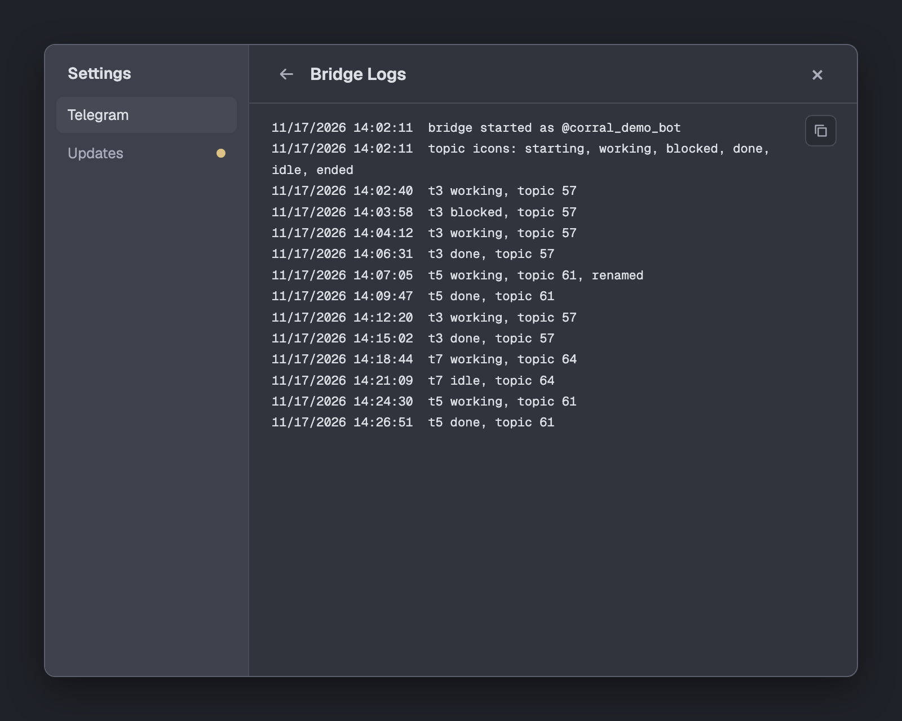

### Files

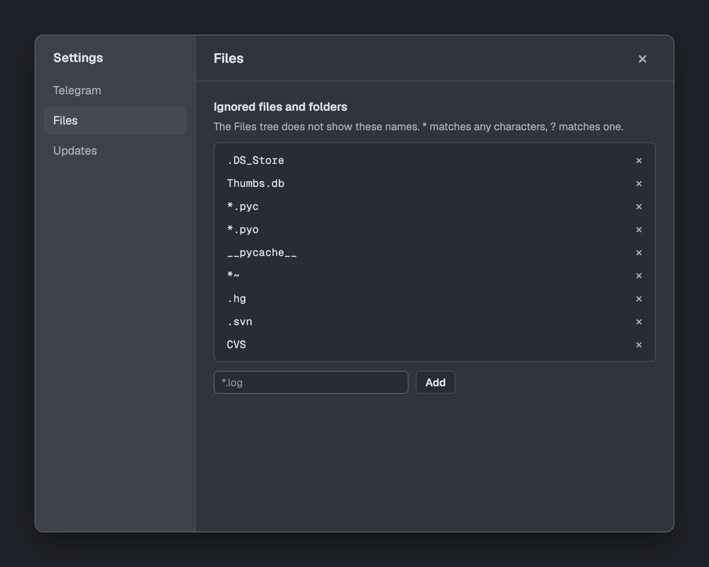

"Ignored files and folders": names the Files tree never shows, as WebStorm's list of the same name. `*` matches any characters and `?` one; a pattern matches a name, never a path, and a folder that matches hides with everything in it. Add with the field and Enter, remove with ×, "Reset to defaults" brings back `.DS_Store`, `Thumbs.db`, `*.pyc`, `*.pyo`, `__pycache__`, `*~`, `.hg`, `.svn` and `CVS`. Changes and Log are not filtered: they show what git sees.

### Restore

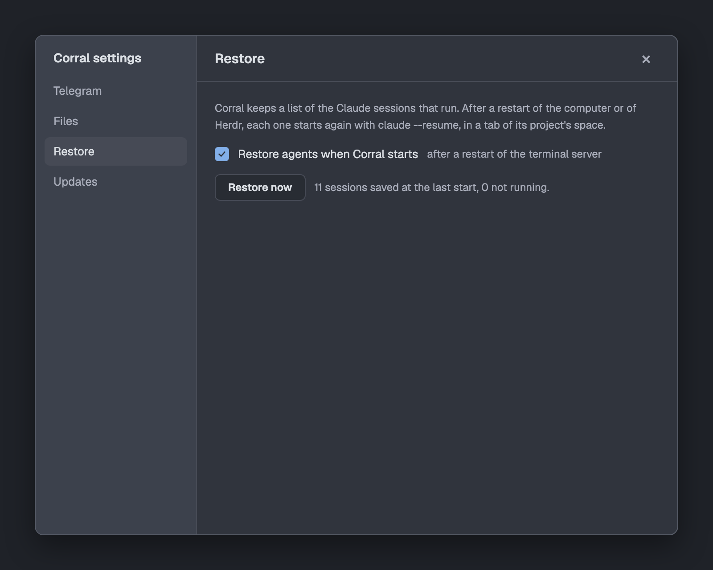

Corral keeps a list of the Claude sessions that run, with each one's folder, space and terminal. A session that ends stays in the list for 30 seconds, so Herdr quitting does not empty it. After a restart of the computer, or of the terminal server (`hc server stop`), Herdr keeps each terminal in its place with an empty shell in it. With "Restore agents when Corral starts" on (the default), Corral then:

1. Says "Restoring the last session…" in a toast.
2. Runs `claude --resume <session id>` in each agent's own terminal. An agent whose terminal is gone gets a tab in its project's space (a new space when none is open).
3. Closes the other empty shells of that restart. The last pane of a space stays.
4. Says how many agents it restored and how many terminals it closed.

It runs once per start of the terminal server: reloading or updating the mod does not start sessions again. A session that runs already, in any space, is never started twice. "Restore now" starts the saved sessions that do not run, at any time.

### Updates

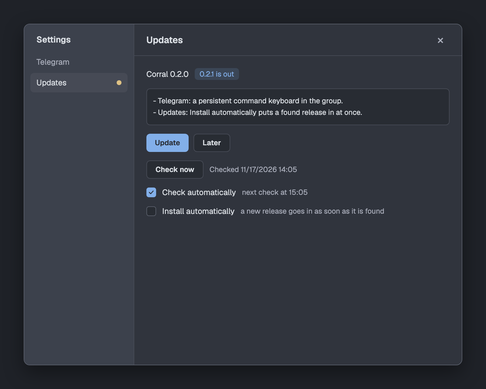

Your version, the latest release and its notes, Update and Later, Check now, "Check automatically" and "Install automatically". Corral checks at start and every hour (it asks github.com where the latest release is, outside the GitHub API's limit); the section shows when the next check runs. When a new release is out, the gear and the section show a yellow dot and a toast says so. Update downloads the release and runs its `install.sh` into this mod's folder; with "Install automatically" on, a found release goes in by itself. A toast says when an update is installed, or why it was not. A `--link` install is never updated from here: use `git pull`.

## Board

The view switch at the top changes what the top area shows: Board, Files, Log or Changes. In the Corral layout, ⌘⌥1, ⌘⌥2, ⌘⌥3 and ⌘⌥4 do the same. In full screen the header drops the room it keeps for the macOS window buttons.


- **Columns:** Needs you, Working, Done, Idle. A card shows the model, the session id (click to copy), the task, context use with tokens, the project, the cost and the time in this status. An agent in a worktree of a project shows that project; outside a saved project the card shows the repository folder, not the worktree. The focused agent's card is outlined. A session that has done work asks before it closes. ↺ restarts the agent: Claude starts again on the same session (`claude --resume`) beside it, in its folder, and the old pane closes.
- **Context colors:** green below 50%, yellow from 50%, red from 80%, as in the statusline. The 5-hour and 7-day plan limits in the header use the same colors and show the reset time. A window whose reset time has passed shows 0%. When a Claude agent works but no session data came for 10 minutes, a yellow "Limits stale" pill says so: the statusline hook does not run (check `statusLine` in `~/.claude/settings.json`).
- **Filters:** "All projects" and "All statuses" open lists with checkboxes. A status you leave out hides its column.
- **+ Agent** starts Claude at the right end of the shown tab (right of its last terminal), at the root of its project. With no terminal in the tab, it opens a new tab. New agents and terminals never start in a worktree: "+ Agent", "+ Terminal", split right and split down start at the project root (outside a saved project, at the root of the git repository).

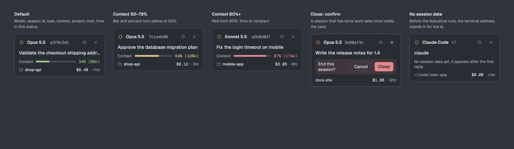

### Projects


The picker lists project folders: saved ones, folders of open spaces (saved when you open them) and folders where an agent runs. Each agent counts once, in the deepest folder that holds it. Rows with an agent that needs you come first; the other rows with agents follow, the one whose agent changed last on top, so a project keeps its place when its agent finishes. A row shows how many of its agents are in each status; the dot on the left has the color of the most urgent one. A project that is not open is a gray square. The legend under the list says what each mark means. A click goes to the agent, else to the open space, else opens a space there and starts Claude. "Add project…" opens the system folder picker and opens a space with Claude in the chosen folder.

Right-click a project for Start Claude here, Open a terminal here and Copy path. The menu opens over the list.

**One space per project.** A new agent that starts in a saved project's folder but in another space moves to a tab of that project's space, with a toast; without a space for the project, Corral opens one. A new agent in your home folder or outside your saved projects goes to the "No project" space. Agents that ran before Corral started stay where they are; `herdr-app do corral.sort` moves them the same way.


### Live workspace

The bar under the board holds the plain terminals of the active space as chips: drag one to reorder, drop it on Right or Below to show it beside the active pane, double-click to rename. "+ Terminal" opens a shell. The chevron folds the terminals away with a short slide and brings them back to the same height; `herdr-app do corral.dock` does the same, so you can bind it to a key. Dragging the divider to the bottom folds them too, and they open to 160 px; dragging it up opens them again. The divider stops where the board reaches its minimum height.


Each pane header shows the status, the agent's task as on its card (the model is in the tooltip; a long task ends in an ellipsis), the session id (click to copy), the context use, a compact button that sends `/compact` after you confirm, the cost, split right, split down, move to its own tab (in its project's space when one is open), restart (as ↺ on the card) and close. Closing an agent that has done work asks first, as its card does; one that has not started closes at once. In a pane narrower than 640 px the session id and the buttons move into a ⋮ menu.


When the space has several tabs, the merge button beside "+ Agent" puts every terminal of the space side by side in the shown tab; the split button next to it does the reverse, a tab for each terminal of the shown tab. `herdr-app do corral.detach`, `corral.merge` and `corral.split` do the same from a command or a key.

## Picking the agent

Files, Log and Changes follow one agent. Two pickers in the header choose it: the project, then an agent of that project. Picking a project picks its first agent; the agent list shows only that project's agents. Picking an agent also focuses its terminal.

## Files

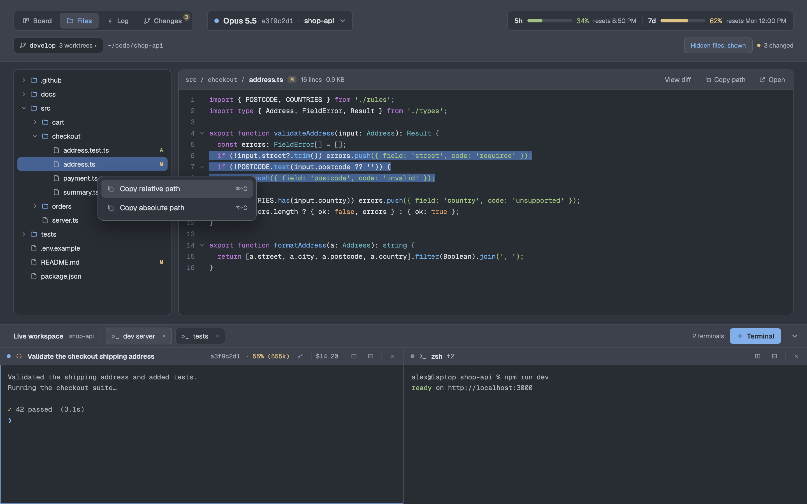

The agent's folder as a tree with git marks (M, A, D), read again every 4 seconds while Files is open, and a read-only code view with syntax colors and text selection. What git ignores (`node_modules`, `dist`, `.env`…) shows dimmed; names in Settings → Files (`.DS_Store` and others by default) do not show at all. A picture (PNG, JPEG, GIF, WebP, BMP, ICO, SVG) shows as a picture, at its own size or fitted to the panel, with its size in pixels; an SVG can also be opened as text. Right-click a row, or press ⌘⇧C / ⌥⇧C (Ctrl+Shift+C / Alt+Shift+C on Linux and Windows), to copy the relative or absolute path. Drag the divider to resize the tree; each agent keeps its own width. The worktree picker shows another worktree of the same repository.

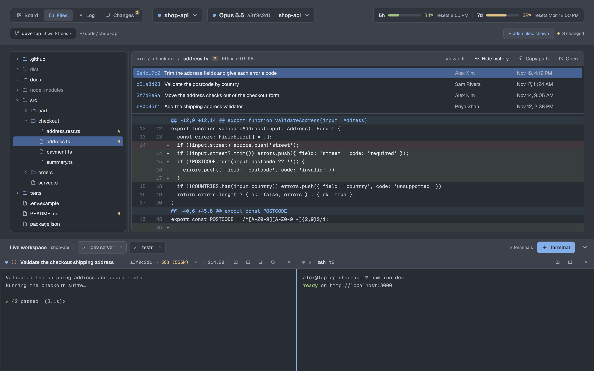

**History** (left of Copy path) shows the commits that changed the open file, renames included (`git log --follow`): hash, subject, author and date. Click a commit, or move with ↑ ↓ (Page Up and Page Down: 20 at a time), to see the file's diff in it. "Hide history" goes back to the file.

## Log


- **Branch tree:** HEAD, Local, Remote and Tags, in folders by `/`. Starred branches come first in their folder. A local branch shows commits to push (↗, green) and to pull (↙, blue) and its tracked branch; click a count to see just those commits. A click on a branch selects its newest commit; a double click filters the log to it.
- **History:** the whole history, the newest 500 commits first. After a click in the list, ↑ ↓ move a commit at a time and Page Up and Page Down 20. The graph works as in IntelliJ: lanes close up to the left, each branch keeps its color, HEAD's commit is a ring, and an edge to a far parent is cut into a down arrow and an up arrow. Click an arrow to jump to the commit at its other end.
- **Filters:** text or hash (with regex and match case), Branch, User and Paths with several values each, and Date. Paths lists the top level; type in its search to find any tracked folder or file below it (`mods/cor` finds `mods/corral`).
- **Details:** the message, hash (click to copy), author, date, refs and the changed files as a tree. Click a file to see its diff in a fourth panel. Another commit opens with its folders open and no diff. A diff scrolls sideways to its longest line, here and in Changes.
- **Copying from a diff** (Changes, Log, file History): press on a line and drag to pick lines, or Shift-click to stretch the pick; ⌘C (Ctrl+C) or the "Copy N lines" button in the diff's corner copies their text without the +/− signs; Esc drops the pick. A diff over 2000 lines is picked by clicks only.

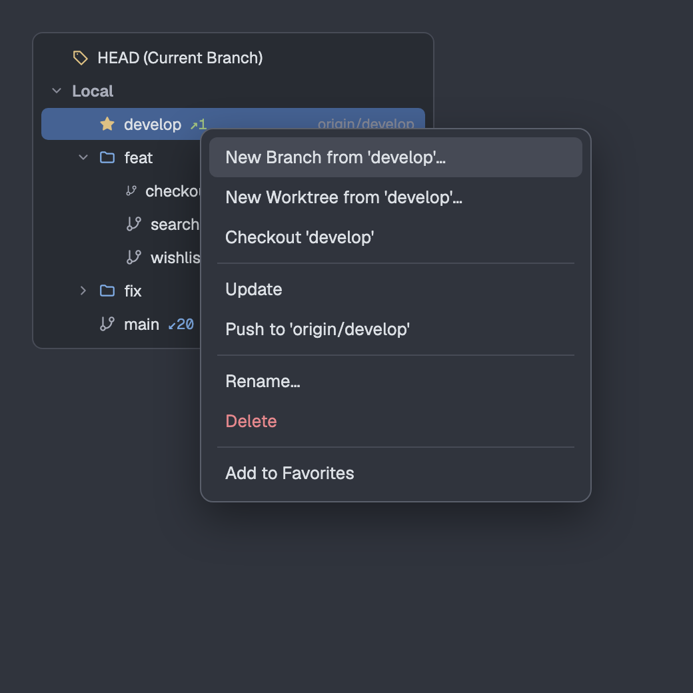

Right-click a branch for: new branch or worktree from it, checkout, update, push, rename, delete (on the remote too, after a confirmation) and star. The fetch button over the list runs `git fetch --all --prune`; opening Log runs it too, without a toast. Each result of a click shows as a toast.

## Changes

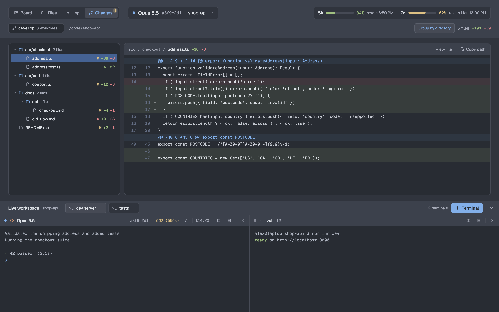

`git status` and `git diff HEAD` of the agent's folder, refreshed every 4 seconds. The files show as a folder tree or a flat list ("Group by directory", kept per repository). Click a file for its diff.

## Telegram

Work with the agents from a Telegram group with Topics. The root topic (General by default) starts agents and pins a dashboard of all of them. Every live Claude Code agent gets a topic of its own, named like its card, `[project] session title`: its status is the topic icon, the reply that ends its turn arrives when it finishes (formatted as the Formatter options say), and its screen with one button per option arrives when it waits for you ("Chat about this" too). What you write in the topic goes to the agent, and so do photos and files. A reply to an earlier message reaches the agent with a line saying which message it answers, and with that message's photo or file. A keyboard with the commands sits under the message field (the keyboard icon opens it; `/help` brings it back).

The bridge is a small Node program (`telegram/`, Node 20+, no dependencies) next to herdr-core, so it keeps working when the Herdr window is closed. It stops while the Mac sleeps; Telegram keeps your messages for 24 hours.

### Set it up

1. In [@BotFather](https://t.me/BotFather), send `/newbot` and keep the token.
2. Make a new Telegram group and turn on Topics in its settings.
3. Open Settings → Telegram, press "Turn on", paste the token and press "Add the bot" and pick the new group. The bridge runs under launchd (`~/Library/LaunchAgents/dev.corral.telegram.plist`): it starts again after a restart of the Mac until you stop it. Its log is `~/.config/herdr-app/corral/telegram.log`; Log in the settings shows it. "Turn off" removes the service; if you remove Corral without that, run `node ~/.config/herdr-app/corral/telegram/bridge.mjs --service uninstall` first.

By hand, without the settings: write `~/.config/herdr-app/corral/telegram.json` (`token`, `chat_id` — the group's negative id, `root_topic_id` — `null` for General, `owner_ids` — your Telegram user id; optional: `reply_format` — `"rich"` or `"markdown"`, `fold_chars` — the Long replies limit), then `node ~/.config/herdr-app/corral/telegram/bridge.mjs --check` and `--service start` (or run it in the foreground without flags). The bridge needs Node 20 or newer.

Keep the group to yourself and the bot: everyone in it reads the agents' screens and replies. Once the bot is in your group, turn off **Allow Groups** for it in BotFather, so nobody can add it elsewhere.

Each topic rename shows as a line in the topic. Mute the group if they distract you: the agents' questions still arrive.

A topic belongs to a Claude session, not to a terminal. A session that goes on elsewhere (Restart, Restore after a reboot, `claude --resume`) keeps its topic: a closed one opens again with "Resumed in …".

### Commands

| Command | Where | What it does |
|---|---|---|
| `/new` | root topic | buttons with your workspaces; a press starts Claude there, to the right of the workspace's agents |
| `/status` | root topic | all agents, their status and a link to their topic |
| `/status` | agent topic | this agent, as its card: status, model, context, cost, folder |
| `/clear` | root topic | delete the topics of ended agents and the bot's topics with no agent, such as those left after Clear all in the settings (also **Clear all** under the dashboard) |
| `/stop` | agent topic | stop the current turn (Esc) |
| `/close` | agent topic | end the agent and close or delete its topic |
| `/help` | anywhere | the commands of this topic, and the command keyboard again |

While an agent waits at a dialog, answer with a button or with `1`…`9`, `y`, `n`, `enter`, `esc`. Other commands in an agent's topic (`/compact`, `/model`…) go to Claude as typed. What you wrote while the bridge was offline is not typed when it comes back: send it again if it still applies. A closed topic takes no messages: the bot removes what you write there.

## Light and dark

The layout follows the system appearance with the `one-light` and `one-dark` themes in `themes/`. Code colors follow the theme.

## Development

```sh
./install.sh --link
```

This symlinks `main.js` and the layout to the checkout, so edits apply when Herdr reloads the mod. Icons stay copies, because Herdr does not load SVGs through a symlinked folder: run the script again after adding one. Check the mod after a change:

```sh
herdr-app check mods/corral
```

```
layouts/corral.json              the layout: header, top area, live workspace
mods/corral/main.js              one mod; props().role picks the part it draws
mods/corral/icons/               SVG icons
mods/corral/keys.json            the view keys, merged into keys.json by install.sh
themes/one-dark.json, one-light.json
statusline/corral-statusline.py  Claude Code statusline hook
telegram/                        the Telegram bridge; tests: node --test telegram/test/
scripts/release.sh               a release: VERSION, tag, GitHub release with the CHANGELOG.md notes
CHANGELOG.md                     one section per release
RECIPE.md                        the brief to rebuild it from scratch
preview.png                      the screenshot herdr.dev shows
```

## License

MIT
