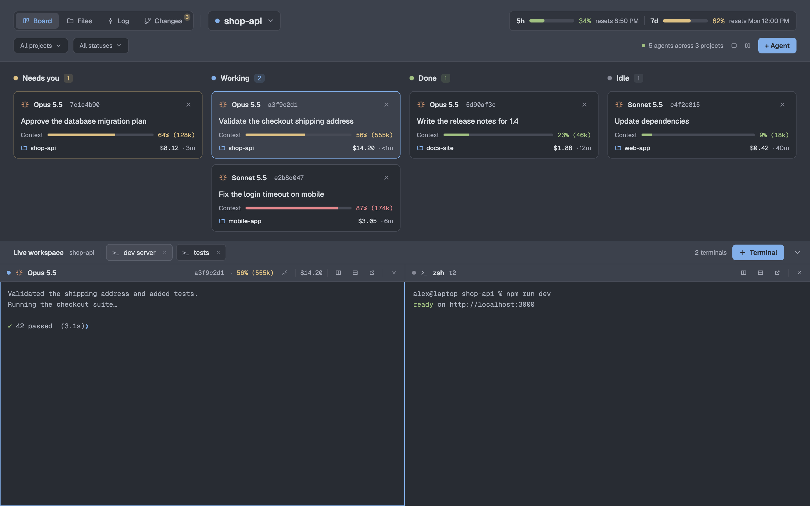
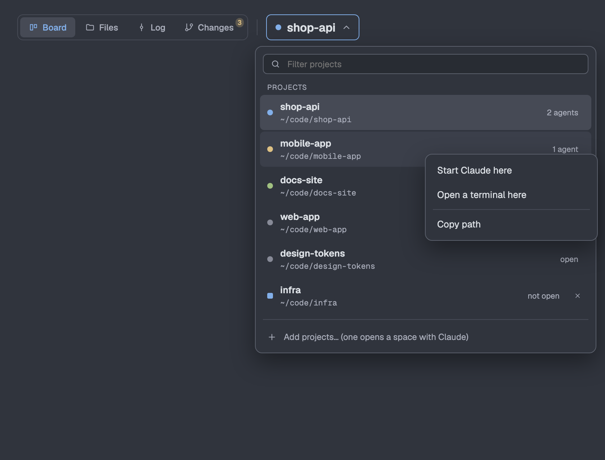
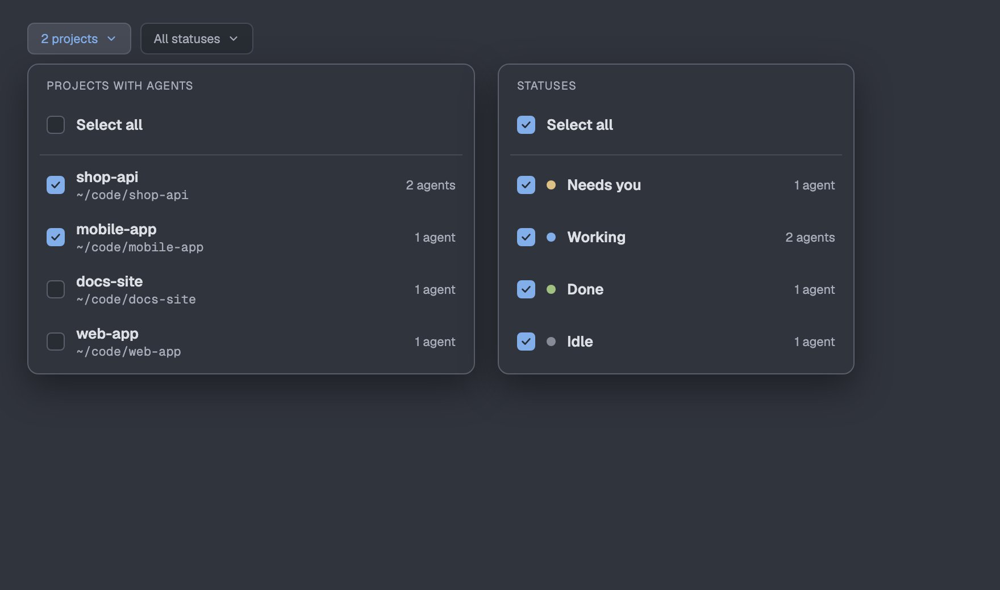
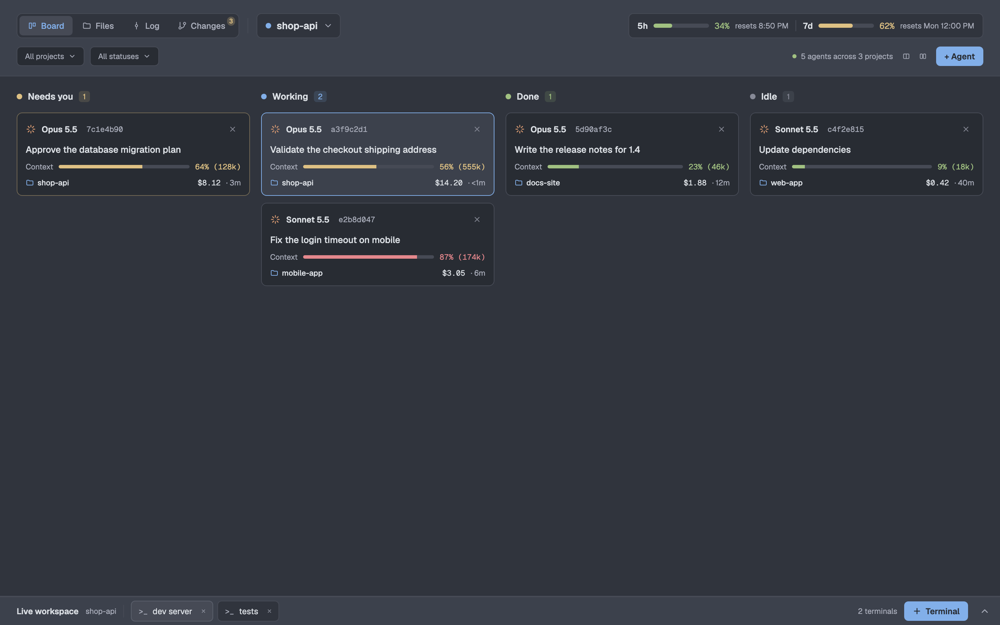
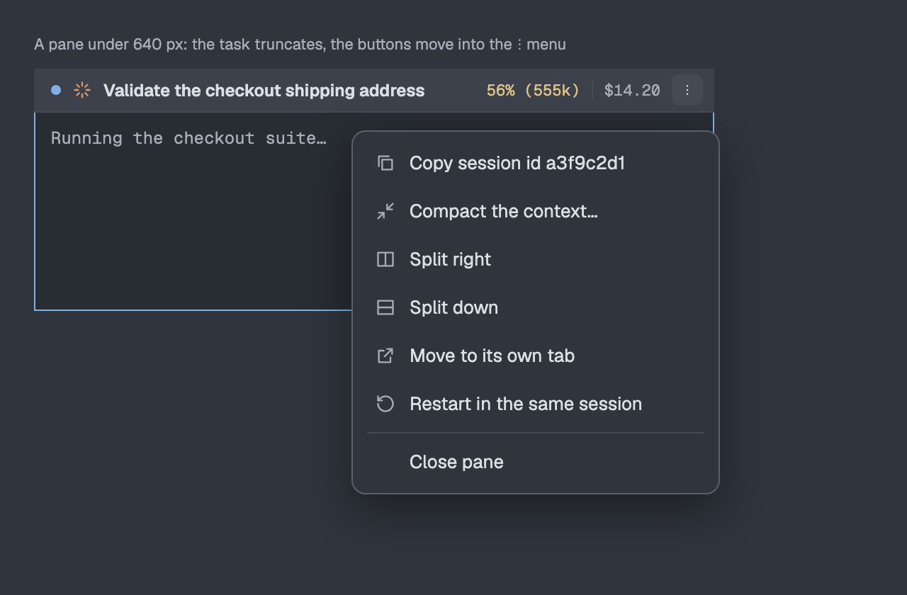
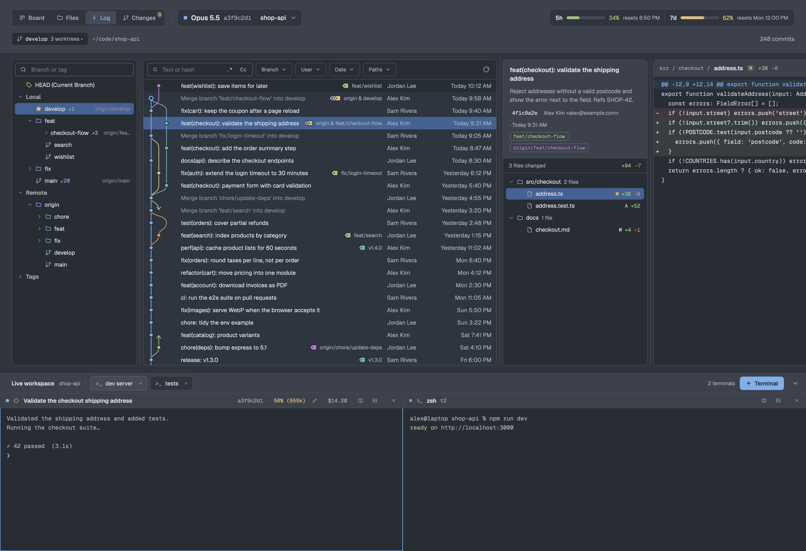

# Corral

An agent board layout for [Herdr](https://herdr.dev). Every Claude Code session is a card, sorted by status. Below the board, the live terminals of the active space. Three more views follow the agent you pick: its files, its git history, and its uncommitted changes.


The screenshots show sample data.

## Install

You need:

- the Herdr desktop app (`herdr-app`);
- Claude Code, for the session data on the cards;
- `git`, for Files, Log and Changes.

Then:

```sh
git clone https://github.com/romant094/corral.git
cd corral
./install.sh --statusline
herdr-app do layout.switch --name corral
```

`install.sh` copies `layouts/corral.json`, `mods/corral/`, `themes/` and the Telegram bridge (`telegram/`) into `~/.config/herdr-app` (or `$HERDR_APP_HOME`), then runs `herdr-app check` on the mod. With `--statusline` it also copies the Claude Code statusline hook into `~/.claude/scripts/`; a hook installed before is always updated. `--name <folder>` installs the mod into another folder, for a gallery install that had to rename it. It also adds Corral's keys (`mods/corral/keys.json`) to your `~/.config/herdr-app/keys.json`; a key you already use keeps its action. Herdr treats an edited `keys.json` as yours and stops adding its new default keys to it. To go back to your own layout, press `ctrl-shift-l` or run `herdr-app do layout.switch --name main`.

### Connect the session data

The cards read the JSON that Claude Code sends to its statusline. Set the hook in `~/.claude/settings.json`:

```json
{
  "statusLine": { "type": "command", "command": "python3 ~/.claude/scripts/corral-statusline.py" }
}
```

The hook prints one line (`model | context | cost | [folder]`) and saves the JSON to `~/.cache/corral/sessions/<claude pid>.json`. The mod matches each file to its terminal by the terminal's foreground pid. If you already have a statusline, call the script from it and pass the same stdin. Without the hook the board still works; the cards say that no session data is available yet.

### What the mod can do on your machine

Herdr mods are trusted JavaScript. Corral:

- runs `git` in the folders of your agents (read commands every few seconds; the branch actions you click also write: checkout, push, delete and so on);
- runs `hc` (herdr-core) to find a terminal's foreground pid and to send `/compact` when you ask for it;
- runs `osascript` on macOS for the multi-folder picker, and `open` for "Open in the default app";
- reads `~/.cache/corral/sessions/` and the files of the folder you browse in Files;
- from the settings: runs `node` with the Telegram bridge, `launchctl` for the bridge's service and writes `telegram.json`.

Network: Corral asks `api.github.com` for its latest release at start and every 6 hours (turn it off in Settings → Updates), and downloads a release from GitHub when you press Update. The Telegram bridge talks to `api.telegram.org` once you turn it on. `git fetch`, `pull` and `push` reach your git remotes when you click them.

## Settings

The gear right of the plan limits (or `herdr-app do corral.settings`) opens the settings:

- **Telegram:** "Turn on", then two steps: paste the bot token (the row links to @BotFather), and make a new group with Topics on and press "Add the bot". Telegram opens, you pick that group and confirm; the bot gets its admin rights, you become its owner, and Corral starts the bridge. The root topic is the group's built-in General ("Restore" brings it back if it was hidden). More owners can be added by login; Export and Import move the settings, token included, to another Mac; Clear all stops the bridge and forgets the settings.
- **Updates:** your version, the latest release and its notes, Update, Check now, and "Check automatically". When a new release is out, the gear shows a dot and a toast says so. Update downloads the release and runs its `install.sh` into this mod's folder. A `--link` install is never updated from here: use `git pull`.

## Board

The view switch at the top changes what the top area shows: Board, Files, Log or Changes. In the Corral layout, ⌘⌥1, ⌘⌥2, ⌘⌥3 and ⌘⌥4 do the same. In full screen the header drops the room it keeps for the macOS window buttons.



- **Columns:** Needs you, Working, Done, Idle. A card shows the model, the session id (click to copy), the task, context use with tokens, the project, the cost and the time in this status. The focused agent's card is outlined. A session that has done work asks before it closes.
- **Context colors:** green below 50%, yellow from 50%, red from 80%, as in the statusline. The 5-hour and 7-day plan limits in the header use the same colors and show the reset time.
- **Filters:** "All projects" and "All statuses" open lists with checkboxes. A status you leave out hides its column.
- **+ Agent** starts Claude to the right of the focused terminal of the shown tab, in that terminal's folder. With no terminal in the tab, it opens a new tab.


### Projects



The picker lists project folders: saved ones, folders of open spaces (saved when you open them) and folders where an agent runs. Each agent counts once, in the deepest folder that holds it. Rows with an agent that needs you come first; the other rows with agents follow, the one whose agent changed last on top, so a project keeps its place when its agent finishes. A row shows how many of its agents are in each status; the dot on the left has the color of the most urgent one. A project that is not open is a gray square. The legend under the list says what each mark means. A click goes to the agent, else to the open space, else opens a space there and starts Claude. "Add projects…" takes several folders at once on macOS.

Right-click a project for Start Claude here, Open a terminal here and Copy path. The menu opens over the list.

**One space per project.** A new agent that starts in a saved project's folder but in another space moves to a tab of that project's space, with a toast; without a space for the project, Corral opens one. A new agent in your home folder or outside your saved projects goes to the "No project" space. Agents that ran before Corral started stay where they are; `herdr-app do corral.sort` moves them the same way.



### Live workspace

The bar under the board holds the plain terminals of the active space as chips: drag one to reorder, drop it on Right or Below to show it beside the active pane, double-click to rename. "+ Terminal" opens a shell. The chevron folds the terminals away with a short slide and brings them back to the same height; `herdr-app do corral.dock` does the same, so you can bind it to a key. Dragging the divider to the bottom folds them too, and they open to 160 px; dragging it up opens them again. The divider stops where the board reaches its minimum height.



Each pane header shows the status, the agent's task as on its card (the model is in the tooltip; a long task ends in an ellipsis), the session id (click to copy), the context use, a compact button that sends `/compact` after you confirm, the cost, split right, split down, move to its own tab (in its project's space when one is open) and close. In a pane narrower than 640 px the session id and the buttons move into a ⋮ menu.



When the space has several tabs, the merge button beside "+ Agent" puts every terminal of the space side by side in the shown tab; the split button next to it does the reverse, a tab for each terminal of the shown tab. `herdr-app do corral.detach`, `corral.merge` and `corral.split` do the same from a command or a key.

## Files


The agent's folder as a tree with git marks (M, A, D), and a read-only code view with syntax colors and text selection. Right-click a row, or press ⌘⇧C / ⌥⇧C (Ctrl+Shift+C / Alt+Shift+C on Linux and Windows), to copy the relative or absolute path. Drag the divider to resize the tree; each agent keeps its own width. The worktree picker shows another worktree of the same repository.

## Log



- **Branch tree:** HEAD, Local, Remote and Tags, in folders by `/`. Starred branches come first in their folder. A local branch shows commits to push (↗, green) and to pull (↙, blue) and its tracked branch; click a count to see just those commits. A click on a branch selects its newest commit; a double click filters the log to it.
- **History:** the whole history, the newest 500 commits first. The graph works as in IntelliJ: lanes close up to the left, each branch keeps its color, HEAD's commit is a ring, and an edge to a far parent is cut into a down arrow and an up arrow. Click an arrow to jump to the commit at its other end.
- **Filters:** text or hash (with regex and match case), Branch, User and Paths with several values each, and Date.
- **Details:** the message, hash (click to copy), author, date, refs and the changed files as a tree. Click a file to see its diff in a fourth panel.


Right-click a branch for: new branch or worktree from it, checkout, update, push, rename, delete (on the remote too, after a confirmation) and star. The fetch button over the list runs `git fetch --all --prune`. Each result shows as a toast.

## Changes


`git status` and `git diff HEAD` of the agent's folder, refreshed every 4 seconds. The files show as a folder tree or a flat list ("Group by directory", kept per repository). Click a file for its diff.

## Telegram

Work with the agents from a Telegram group with Topics. The root topic (General by default) starts agents and pins a dashboard of all of them. Every live Claude Code agent gets a topic of its own, named like its card, `[project] session title`: its status is the topic icon, its last reply arrives when it finishes, and its screen with one button per option arrives when it waits for you. What you write in the topic goes to the agent, and so do photos and files.

The bridge is a small Node program (`telegram/`, Node 20+, no dependencies) next to herdr-core, so it keeps working when the Herdr window is closed. It stops while the Mac sleeps; Telegram keeps your messages for 24 hours.

### Set it up

1. In [@BotFather](https://t.me/BotFather), send `/newbot` and keep the token.
2. Make a new Telegram group and turn on Topics in its settings.
3. Open Settings → Telegram, press "Turn on", paste the token and press "Add the bot" and pick the new group. The bridge runs under launchd (`~/Library/LaunchAgents/dev.corral.telegram.plist`): it starts again after a restart of the Mac until you stop it. Its log is `~/.config/herdr-app/corral/telegram.log`. "Turn off" removes the service; if you remove Corral without that, run `node ~/.config/herdr-app/corral/telegram/bridge.mjs --service uninstall` first.

By hand, without the settings: write `~/.config/herdr-app/corral/telegram.json` (`token`, `chat_id` — the group's negative id, `root_topic_id` — `null` for General, `owner_ids` — your Telegram user id), then `node ~/.config/herdr-app/corral/telegram/bridge.mjs --check` and `--service start` (or run it in the foreground without flags). The bridge needs Node 20 or newer.

Keep the group to yourself and the bot: everyone in it reads the agents' screens and replies. Once the bot is in your group, turn off **Allow Groups** for it in BotFather, so nobody can add it elsewhere.

Each topic rename shows as a line in the topic. Mute the group if they distract you: the agents' questions still arrive.

### Commands

| Command | Where | What it does |
|---|---|---|
| `/new` | root topic | buttons with your workspaces; a press starts Claude there, to the right of the workspace's agents |
| `/status` | root topic | all agents, their status and a link to their topic |
| `/status` | agent topic | this agent, as its card: status, model, context, cost, folder |
| `/clear` | root topic | delete the topics of ended agents (also **Clear all** under the dashboard) |
| `/stop` | agent topic | stop the current turn (Esc) |
| `/close` | agent topic | end the agent and close or delete its topic |
| `/help` | anywhere | the commands of this topic |

While an agent waits at a dialog, answer with a button or with `1`…`9`, `y`, `n`, `enter`, `esc`. Other commands in an agent's topic (`/compact`, `/model`…) go to Claude as typed. What you wrote while the bridge was offline is not typed when it comes back: send it again if it still applies. A closed topic takes no messages: the bot removes what you write there.

## Light and dark

The layout follows the system appearance with the `one-light` and `one-dark` themes in `themes/`. Code colors follow the theme.

## Development

```sh
./install.sh --link
```

This symlinks `main.js` and the layout to the checkout, so edits apply when Herdr reloads the mod. Icons stay copies, because Herdr does not load SVGs through a symlinked folder: run the script again after adding one. Check the mod after a change:

```sh
herdr-app check mods/corral
```

```
layouts/corral.json              the layout: header, top area, live workspace
mods/corral/main.js              one mod; props().role picks the part it draws
mods/corral/icons/               SVG icons
mods/corral/keys.json            the view keys, merged into keys.json by install.sh
themes/one-dark.json, one-light.json
statusline/corral-statusline.py  Claude Code statusline hook
telegram/                        the Telegram bridge; tests: node --test telegram/test/
scripts/release.sh               a release: VERSION, tag, GitHub release with the CHANGELOG.md notes
CHANGELOG.md                     one section per release
RECIPE.md                        the brief to rebuild it from scratch
preview.png                      the screenshot herdr.dev shows
```

## License

MIT
