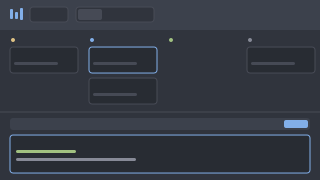

# Corral

Agents as cards in four columns: Needs you, Working, Done and Idle. Under the board, the live terminals of the active space. Files and Changes views show the folder and the git changes of one agent.

This file is the brief: enough to build Corral from an empty folder. The files next to it are one build of it.

## What you see

Three bands, top to bottom, no title bar, theme `one-dark`:

1. **The header**, 112px, chrome color. Row one: the view switch Board | Files | Changes (the change count floats on the corner of Changes), "/", a picker, and the plan limit pills on the right. The picker selects the project on Board and the agent on Files and Changes. Row two depends on the view: on Board, project and status filter dropdowns with checkboxes, the agent count and "+ Agent"; worktree picker, folder path, hidden-files chip and change count on Files; worktree picker, repository path and +/− totals on Changes. Rows are fixed from the top, so a view change does not move them.
2. **The top area**, 355px by default, resizable against the workspace. Board: four columns of cards. Files: a 280px tree and a read-only code view. Changes: a 320px list of changed files and a diff with old and new line numbers.
3. **The workspace**, the remaining height. A 40px rail with "Live workspace", the plain terminals of the active space as chips, their count and "+ Terminal". Below, the active tab's panes with a 30px header each: status dot, model, session id, colored context use, cost, split right, split down, close.

## How it behaves

- Cards cover all spaces by default; chips narrow them to this space or to agents that need attention. Clicking a card focuses its agent.
- Session data comes from the Claude Code statusline hook. One mod copy reads `~/.cache/corral/sessions/*.json` every 3s, matches each file to a terminal by `hc get <address> --json` → `foreground.pid`, and publishes the result with `setShared`.
- Closing a card closes at once when the session has no tokens; otherwise the card asks first.
- Files and Changes follow the focused agent. The agent picker pins another agent and focuses its terminal. A picked worktree replaces the agent's folder until the agent changes.
- git runs through `exec("git", …, { cwd })`: `rev-parse`, `branch --show-current`, `worktree list --porcelain`, `status --porcelain=v1`, `diff --numstat HEAD`, and `diff HEAD -- <path>` for the selected file.
- The code view is `Editor` with `EditorState.new({ readonly: true, … })`, created in the click that opens a file.

## Built from

- **The layout** (`layouts/corral.json`): a root `column`; a fixed header `block`; a resizable `column` with the top block and the workspace `column`, which holds the rail block and `content: { tab: "active", pane: { … } }`.
- **One mod** (`mods/corral/`), selected by `props().role`: `header`, `terminals`, `pane`, `spaces`, `agents`, `worktrees`, or none for the top area.
- **Shared keys:** `corral.filter`, `corral.projects`, `corral.live`, `corral.view`, `corral.target`, `corral.git`, `corral.hidden`, `corral.worktree`.

## Watch out

- `h_flex` centers its children vertically. Stretch panel rows with `items_stretch()`, or the panels collapse.
- A virtual `uniform_list` rendered nothing in the tree panel; the tree is a plain scrolled list.
- Editor state can't be created during render.
- There is no drag and drop across blocks; the rail draws its own drop zones.

## Done when

- Every agent appears in the right column with session data after its first reply.
- Board, Files and Changes switch without moving the header.
- Files shows the tree and opens a file with selectable text; Changes lists the changes and shows a diff.
- `herdr-app check mods/corral` passes.
