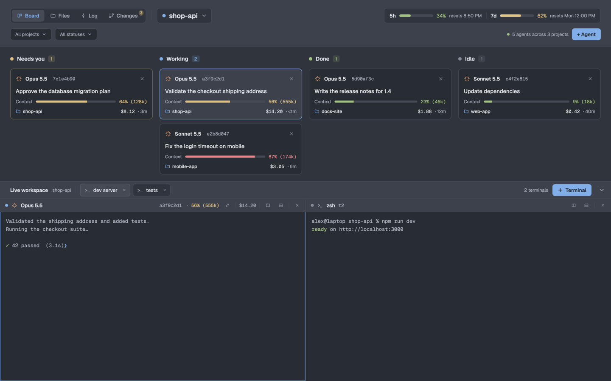

# Corral

A board of Claude Code agents: one card per session in four columns, Needs you, Working, Done and Idle. Under the board, the live terminals of the active space. Three more views follow the agent you pick: Files (its folder and code), Log (its git history with a branch tree and a graph) and Changes (its uncommitted changes).

This file is the brief: enough to build Corral from an empty folder. The files next to it are one build of it.

## What you see

No title bar. Theme `one-dark` in dark mode, `one-light` in light mode (`themes/`). UI font Geist 13px, code Geist Mono. Three bands, top to bottom:

1. **Header**, 112px, `chrome` background, 24px side padding, rows fixed from the top so a view change never moves them.
   - Row one, at 19px: the view switch `Board | Files | Log | Changes` (28px tabs in a bordered group; the active tab `selected` background and `accent` text; Changes carries the change count as a 13px badge on its top-right corner, over the word, so the switch never changes width); a 22px vertical line; the picker (Board: dot, project name, ▾; Files, Log, Changes: status dot, model, 8-hex session id, project, ▾); on the right one limit pill: `5h` and `7d` groups split by a 16px vertical line, each with an 80px meter, percent and "resets 8:50 PM".
   - Row two depends on the view. Board: "All projects ▾", "All statuses ▾", then on the right "N agents across N projects" and a solid `accent` "+ Agent". Files: worktree picker, folder path, "Hidden files" chip, change count. Log: worktree picker and repository path. Changes: worktree picker, repository path, "Group by directory" chip, file count, +/− totals.
2. **Top area**, resizable against the workspace (min 150px), `canvas` background, 24px side padding.
   - Board: four equal columns with a header (dot, title, count) and cards: program icon, model, session id, ×; the task (session name, else the tab name); "Context" meter and "56% (555k)"; project, cost, time in this status. The focused agent's card has an `accent` border.
   - Files: a tree (280px) and a code view with line numbers and fold marks; the tree marks files M, A, D.
   - Log: four panels with dividers: branch tree (260px), commits, details (380px), and a file diff (only when a file is open).
   - Changes: a changed-file tree or list (320px) and a diff with old and new line numbers.
3. **Live workspace**, 460px by default, edge to edge. A 40px bar in `chrome`: "Live workspace", the space name, plain terminals as chips, their count, "+ Terminal", a chevron. Below, the active tab's panes, square, 1px apart, each with a 30px header: status dot, program icon, model; on the right session id, colored context use, compact button, a line, cost, a line, split right, split down, a line, ×.

Context and limit colors: below 50% `done` (green), from 50% `blocked` (yellow), from 80% `ansi9` (red).

## How it behaves

- **Statuses.** `blocked` cards sit in Needs you (yellow dot), `working` in Working (blue), `done` in Done (green), `idle` in Idle (grey). A card shows "· 3m" since its status last changed. A click on a card focuses its agent; the × closes at once when the session has no tokens, else asks "End this session?" inside the card.
- **Session data.** The statusline hook saves Claude Code's JSON per claude pid to `~/.cache/corral/sessions/`. The board copy reads them every 3s and matches each file to an agent by `hc get <address> --json` → `foreground.pid`, looked up again every 10s. The plan limits come from the newest file that has `rate_limits`.
- **Projects.** One list of folders: saved ones, folders of open spaces (saved when seen), folders of agents. Each agent counts in the deepest folder that holds it. Rows with agents first, then open, then not open. A click goes to the agent, else to the space, else `space.new` there with `claude`. "Add projects…" uses `osascript` `choose folder … with multiple selections allowed` on macOS, else `pickFolder`.
- **Filters.** Project and status popups with checkboxes and "Select all"; checking every item goes back to "all". A status left out hides its column.
- **Live workspace.** Chips drag to reorder; dropped on Right or Below they show beside the active pane; a double click renames. "+ Terminal" runs `tab.new` in the space. The chevron resizes the workspace to 40px in 12 eased steps over 200ms and hides the panes, then back to its last height. Presses on the header, the top area and the bar keep the keyboard, so no terminal gets focus from them.
- **Compact.** The pane header's compact button asks "Compact the context?" and on Compact runs `hc send <terminal> /compact`.
- **Files.** Clicking a file opens it in a read-only `Editor` with syntax colors. Right-click a row for "Copy relative path" (from the repository root) and "Copy absolute path"; `cmd-shift-c` / `alt-shift-c` do the same (`ctrl-shift-c` off macOS), bound with `bind_keys` in a `CorralPaths` key context.
- **Changes.** `git status` and `git diff --numstat HEAD` every 4s, one at a time. Grouped by directory by default, kept per repository; single-folder chains join ("src/checkout"); indents step 20px, files 17px further in.
- **Log.**
  - Loads the newest 500 commits, then the whole history (`git log --date-order`, up to 100000); every 10s it reads refs and HEAD and reloads the history only if they moved.
  - Graph: lanes close up to the left; a branch keeps its color; an edge to a parent more than 30 rows down is cut into a down arrow under the child (a diagonal into the next lane, then a V) and an up arrow over the parent (a lane starting one row above with a ^), both in the child's color. A press within 8px of an arrow selects the commit at the other end and scrolls to it; the arrow area lights up under the pointer. HEAD's dot is a ring; commits reachable from HEAD get a light `accent` tint.
  - Refs in a row: stacked left-pointing tag icons (HEAD yellow in front, local green, remote purple, tags teal), each filled with the row color, then grey text with a branch and its remote twin joined ("origin & main"); `origin/HEAD` is left out.
  - Branch tree: a click selects the branch's newest commit, a double click filters to it. Counts ↗ and ↙ from `%(upstream:track)`; a click filters to `upstream..branch` or `branch..upstream`. Starred branches (kept per repository) come first in their folder with a star icon.
  - Right-click a local branch: New Branch from…, New Worktree from… (folder beside the other worktrees), Checkout, Update (`pull --ff-only`, or `fetch origin b:b`), Push, Rename…, Delete (asks; "Delete anyway" for unmerged), Add to Favorites. A remote branch: new branch or worktree from it, Checkout (`--track`), favorites, Delete on the remote (`push origin --delete`). Push, update, checkout and the dialogs' commands run in the board copy, with "Pushing…" blinking beside the branch, and end in a toast.
  - Filters over the list: text or hash with `.*` and `Cc`, and Branch, User, Paths (several values each) and Date (one start date). Text, user and path filters hide the graph.
  - Details: message, hash (click copies), author and email, date, refs, changed files as a tree; a click opens the file's diff in the fourth panel.

## Built from

- **Layout** (`layouts/corral.json`): root `column`, `titlebar: "none"`, theme `{ light: "one-light", dark: "one-dark" }`. A 112px `block` `board-header` (mod role `header`, `window_drag`); a resizable `column` `board-body` with a 1px `border` divider holding the `block` `board-cards` (the mod, no role, min 150) and the `column` `workspace` (460px, min 40), which holds `workspace-title` (40px, role `terminals`) and `live-terminals` (`tab: "active"`, panes with a 30px header of role `pane`, `gap: 1`, `radius: 0`, `lone: true`, `focus` border in `accent`).
- **One mod** (`mods/corral/main.js`) drawn by role: none (the top area: board, files, log, changes), `header`, `terminals`, `pane`, and popups `spaces` (projects), `agents`, `worktrees`, `projectfilter`, `statusfilter`, `pathmenu`, `branchmenu`, `gitdialog`, `logfilter`. Popups get an explicit height.
- **Only the board copy** reads sessions, runs git, keeps the queue of git jobs and publishes them through shared keys: `corral.live`, `corral.git`, `corral.view`, `corral.target`, `corral.filter`, `corral.projects`, `corral.worktree`, `corral.widths`, `corral.dock`, `corral.favorites`, `corral.hidden`, `corral.logFilter`, `corral.logMeta`, `corral.gitJobs`, `corral.gitResults`, `corral.gitBusy`, `corral.gitBump`, `corral.changeTree`.
- **herdr functions:** `agents`, `spaces`, `panes`, `props`, `run`, `setAgentOrder`, `theme`, `shared`/`setShared`, `pickFolder`, `home`, `hc`, `exec`, `readTextFile`, `openOverlay`/`closeOverlay`, `notify`, `window`, `layout`. Commands: `agent.focus`, `space.select`, `space.new`, `tab.new`, `pane.split`, `pane.close`, `layout.resize`, `layout.show`, `layout.hide`.
- **UI:** `gpui-kit` `div`, `svg`, `image`, `uniform_list`, `PathBuilder` with `window.paint_path` for the graph and tags; `gpui-base` `h_flex`, `v_flex`, `Input`, `Editor`, `h_resizable`, `resizable_panel`, `v_virtual_list` with a `VirtualListScrollHandle`.
- **Programs:** `git`, `hc`, `osascript` and `open` on macOS. **Art:** 17 SVG icons in `mods/corral/icons/`.
- **Statusline hook:** `statusline/corral-statusline.py`.

## Watch out

- `init(props)` gets empty props: read the role with `props()`.
- `h_flex` centers children vertically; stretch panel rows with `items_stretch()`. A `flex_1` list inside a popup or panel with no explicit height collapses to nothing.
- Pointer handlers work on `div`, `h_flex`, `v_flex`, not on a virtual list: wrap the list to read where a press landed.
- A dialog or popup does not finish work it awaits: queue git commands through shared state for the board copy to run. Build only the dialog's own command; reading a field another dialog has throws.
- `flex_shrink()` needs a number. `EditorState` and `InputState` can't be made in `render`. Herdr loads no SVG through a symlinked mod folder.
- Every `setShared` redraws every copy: write only changed values. Keep per-render work off the whole history: index commits by hash, keep the graph width and the filtered list.
- The code view's selection color is the theme's `hover`, and its gutter is `surface`.
- Without the statusline hook the cards have no session data. Git commands run with `GIT_TERMINAL_PROMPT=0` and SSH in batch mode: a remote that wants a password fails at once.

## Done when

- `herdr-app check mods/corral` passes and `layout.switch {name: "corral"}` shows the three bands with no errors in `herdr-app status`.
- Every agent shows in its status column, and its card gets model, context and cost after its first reply.
- The view switch changes the top area without moving the header; the agent picker focuses the agent's terminal.
- Files opens a file with selectable text; ⌘⇧C copies its relative path.
- Changes lists the changed files as a tree and shows a diff.
- Log shows the whole history with lanes and cut edges; clicking an arrow jumps to the other end; the Branch filter with two branches shows both histories.
- A branch created, renamed and deleted from the branch menu shows each change in the tree and a toast.
- The chevron folds the terminals to the bar and opens them to the same height.
